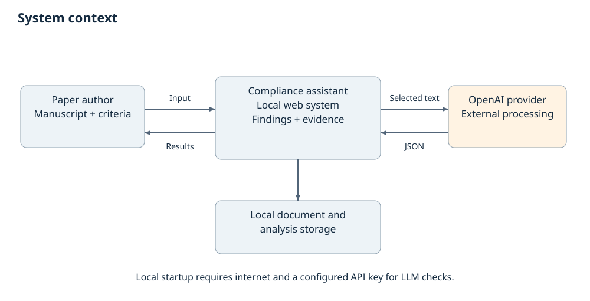
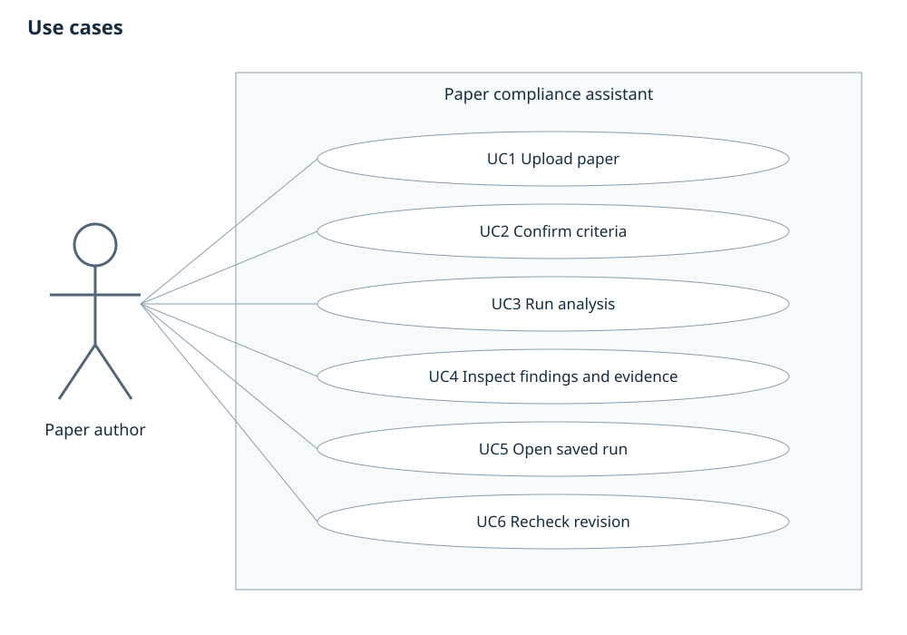
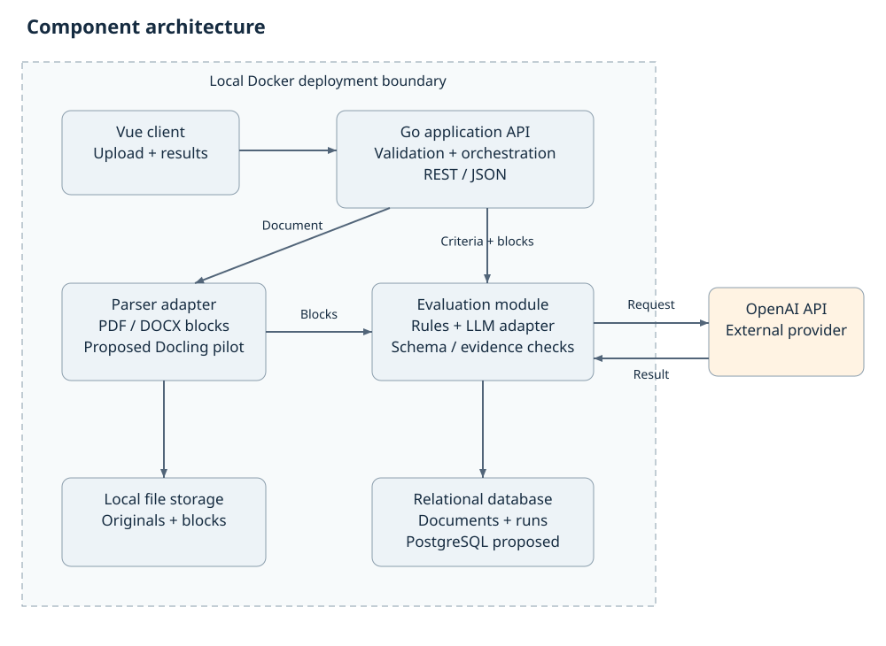

# 7 Architecture and diagrams

The context, use-case and component diagrams describe the same local single-user system. The author operates a Vue client; the Go application coordinates storage, document parsing, rule checks and external LLM requests. The parser and judge are replaceable adapters. The external AI provider is outside the local trust boundary. No separate admin system or multi-user authentication is assumed for the first local MVP.

## Processing flow and data model

The backend validates an upload and computes its content hash, stores the file under a generated path, extracts structured blocks, and displays extraction warnings. The user confirms normalized criteria. A versioned analysis run then executes supported rules and semantic checks, validates results and evidence, persists the outcome and returns it for inspection. A provider failure yields an explicit failed run. Rechecking a revision creates a separate run.

| Entity | Key data | Relationship |
| --- | --- | --- |
| Document | ID, hash, media type, file path, parser version, extraction status | Has many blocks and analysis runs. |
| Block | Document ID, block ID, section, text, nullable page, anchor | Referenced by result evidence. |
| CriteriaSet and Criterion | Version, original source, confirmed wording, type, threshold, priority | A run references one immutable confirmed version. |
| AnalysisRun | Document ID, criterion-set version, prompt/schema/model IDs, settings, status, timestamps | Has one finding per criterion and measured token/latency metadata. |
| Finding | Criterion ID, status, engine, explanation, source anchors, recommendation | Belongs to one run; valid source references are checked. |

Proposed REST resources are POST /api/documents, POST /api/criteria-sets, POST /api/analyses, GET /api/analyses/{id}, GET /api/analyses and DELETE /api/documents/{id}. Runs may expose queued, processing, completed and failed states; the first implementation can use a local worker without a separate distributed queue. Schema examples and data-model notes are included as editable repository files.

## Reliability boundaries

Uploaded article and requirement text are untrusted data: instructions embedded in them must not change the system prompt, trigger tools or override the rubric. Do not execute document macros. Validate model-generated anchors against extraction output; keep unsupported checks visible. Store keys server-side and exclude raw private manuscripts from Git. These controls are requirements to implement and test, not security guarantees already achieved.

## Storage history deletion and provider consent

The Go API owns persistence. It writes original files and extracted blocks to generated local paths, and metadata, immutable criteria versions, runs and findings to relational storage. GET history and GET run read saved data through Go; they do not invoke the LLM again. The component diagram shows direct bidirectional Go/storage connections.

UC1/UC3: explain the configured external provider and the extracted content to be sent, require confirmation for that run, and make no provider request after cancellation. UC5: list saved run IDs, reopen a run using its stored version/configuration and clearly show a missing document. Deletion requires confirmation of the document and dependent runs, removes linked blocks/findings/local files and reports failure honestly; original private content is never committed to Git.

The complete FR to component/data/API mapping and request/error examples are in docs/ARCHITECTURE_TRACEABILITY.md and docs/API_CONTRACT.md. These are design contracts, not implemented endpoints.
